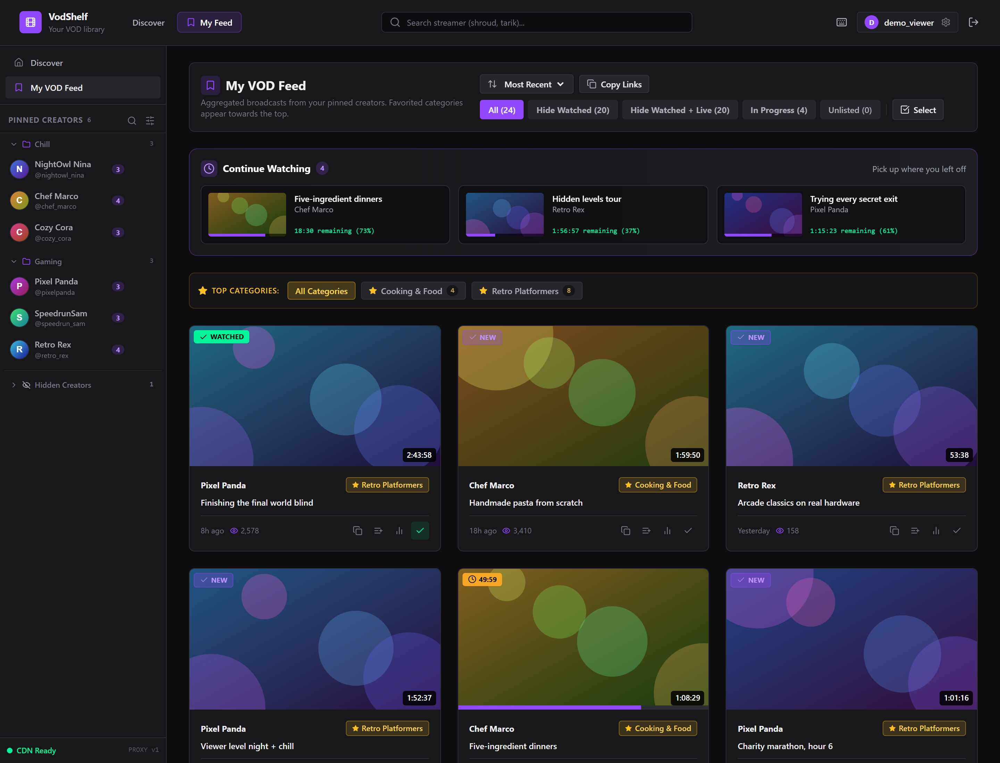
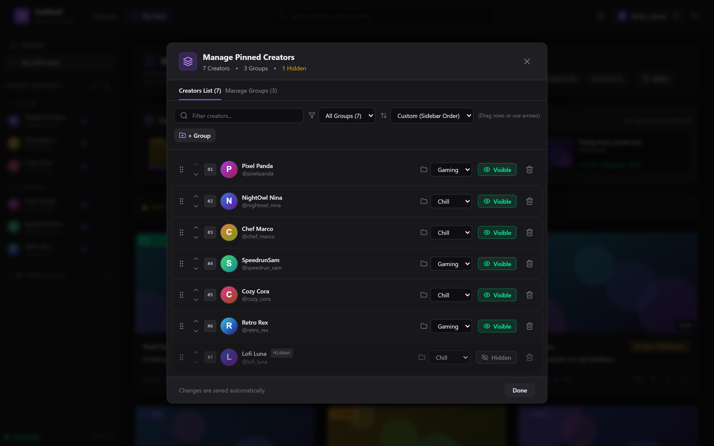
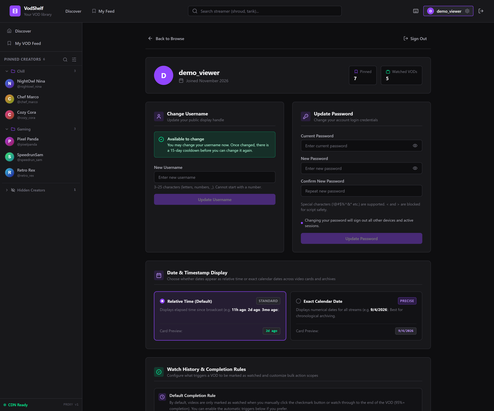
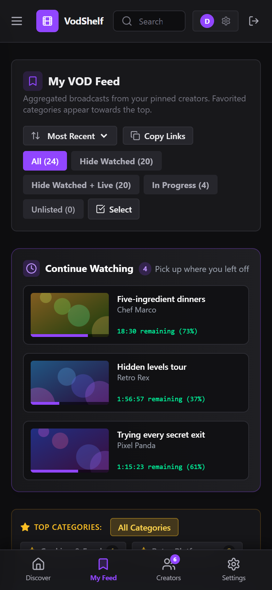

# VodShelf

A self-hosted web app for browsing Twitch past broadcasts, tracking what you've watched, and playing VODs directly in the browser. Built because Twitch's own VOD page is paginated to ~20 videos and makes it impossible to dig through a streamer's full catalog.

## Screenshots

All screenshots use fictional demo data.



| Manage pinned creators | Settings | Mobile |
|---|---|---|
|  |  |  |

## What it does

**Browse any channel's full VOD history** — Queries Twitch's internal GraphQL API with cursor-based pagination so you can scroll through hundreds of past broadcasts, highlights, and uploads without hitting the artificial page limits of the Twitch website.

**Watch VODs directly in the browser** — An integrated HLS player (via `hls.js`) streams video from Twitch's CloudFront CDN at source quality. No redirects, no ads, no external player needed. Defaults to the highest available quality, with manual quality selection (1080p60, 720p60, 480p, 360p, 160p), playback speed controls (0.75x–1.5x), and full keyboard shortcuts:

| Key | Action |
|-----|--------|
| `Space` | Play / Pause |
| `←` / `→` | Seek ±10 seconds |
| `F` | Toggle fullscreen |
| `M` | Toggle mute |
| `Esc` | Close player |

**Track watch progress across sessions** — Playback position syncs to the server every 10 seconds. When you come back to a VOD, it picks up where you left off. VODs are automatically marked as "watched" when you hit 95% completion. You can also manually toggle watched status, or batch-select multiple VODs and mark them all at once.

**Pin streamers and build a personalized feed** — Pin the channels you follow into a sidebar. Their latest VODs aggregate into a single feed view, sorted chronologically with favorited game categories bubbled to the top. Filter the feed by "All", "Unwatched", or "In Progress" to find what you haven't seen yet.

**Organize pinned creators into groups** — Custom folders for your sidebar (e.g., "FPS", "Variety", "IRL"). Rename groups, delete them, move creators between them. You can also hide creators from the feed and sidebar without unpinning them — they go into a collapsible "Hidden Creators" drawer so they're still there when you need them.

**Browse VODs by game category** — Each streamer profile has a Categories tab that groups their broadcasts by game. Star your favorite categories and they'll be prioritized in your feed. Click into any category to see just the VODs from that game, with type filters (Archive / Highlight / Upload).

---

## Tech stack

| Layer | Technology |
|-------|-----------|
| Framework | Next.js 14 (App Router) |
| Language | TypeScript |
| UI | React 18, Tailwind CSS |
| Database | SQLite via `@libsql/client` |
| Auth | Stateless JWT (HS256) with `jose`, bcrypt password hashing |
| Video | `hls.js` for HLS playback |
| Icons | `lucide-react` |
| Data source | Twitch GQL (public, no API keys required) |

The entire app runs as a single Next.js process with an embedded SQLite database (`archive.db`). No external services, no Redis, no Postgres. One `.env.local` file and `npm run dev`.

---

## Getting started

### Prerequisites

- Node.js 20+
- npm

### Setup

```bash
# Clone the repo
git clone https://github.com/jt-ito/vodshelf.git
cd vodshelf

# Install dependencies
npm install

# Create your environment file
cp .env.example .env.local
```

Open `.env.local` and set a strong `JWT_SECRET`:

```bash
# Generate a 64-character hex secret
node -e "console.log(require('crypto').randomBytes(32).toString('hex'))"
```

Paste the output as the value:

```env
JWT_SECRET=your_generated_secret_here
```

### Run

```bash
npm run dev
```

Open [http://localhost:3000](http://localhost:3000). The database is created automatically on first start.

### Production

```bash
npm run build
npm start
```

The `Secure` cookie flag and security headers are automatically enabled outside of development mode.

---

## Project structure

```
├── app/
│   ├── api/
│   │   ├── auth/           # Register, login, logout, session check
│   │   ├── categories/     # Favorite game categories
│   │   ├── proxy/m3u8/     # HLS stream proxy with SSRF-safe allowlist
│   │   ├── streamers/      # Pinned creators, personalized feed
│   │   ├── twitch/         # Channel search and VODs
│   │   ├── user/           # Password change, username change, settings
│   │   └── watch/          # Watch progress & bulk status updates
│   ├── globals.css
│   ├── layout.tsx
│   └── page.tsx            # Single-page app shell
├── components/
│   ├── AuthModal.tsx        # Login / register modal
│   ├── CdnRecoveryTab.tsx   # Playback source tools
│   ├── FeedView.tsx         # Aggregated VOD feed from pinned creators
│   ├── LandingHero.tsx      # Home page with search & quick channels
│   ├── Navbar.tsx           # Top bar with search autocomplete
│   ├── PinnedManagementModal.tsx  # Full creator management (groups, visibility, bulk ops)
│   ├── Sidebar.tsx          # Left sidebar with pinned creators & groups
│   ├── StreamerCategoriesTab.tsx  # Game category browser per channel
│   ├── StreamerHeader.tsx   # Channel profile banner
│   ├── StreamerView.tsx     # Channel page (VODs, categories)
│   ├── Toast.tsx            # Toast notification system
│   ├── UserSettingsView.tsx  # Account settings, password/username change
│   ├── VideoPlayerModal.tsx  # HLS video player with quality/speed controls
│   └── VodCard.tsx          # VOD thumbnail card with watch status
├── lib/
│   ├── auth/session.ts      # JWT creation, verification, token versioning
│   ├── cache/ttl-cache.ts   # In-memory TTL cache with request coalescing
│   ├── db/index.ts          # SQLite schema & migrations
│   ├── logger.ts            # Structured JSON logger with secret redaction
│   ├── security/
│   │   ├── errors.ts        # Safe error responses (no leak)
│   │   ├── rate-limit.ts    # Per-IP rate limiting
│   │   └── sanitize.ts      # Input validation & XSS prevention
│   └── twitch/
│       ├── cdn-prober.ts    # Playback manifest resolution
│       └── gql.ts           # Twitch GQL queries (search, VODs, metadata)
├── middleware.ts             # CSRF protection & security headers
├── archive.db               # SQLite database (auto-created, gitignored)
└── .env.local               # JWT_SECRET (gitignored)
```

---

## Database

Four tables, all with `user_id` scoping so users can't see each other's data:

| Table | Purpose |
|-------|---------|
| `users` | Accounts with bcrypt hashes, token versioning, username change cooldown |
| `pinned_streamers` | Creator pins with custom groups, visibility toggle, sort order |
| `watch_status` | Per-VOD progress (seconds), watched flag, last watched timestamp |
| `favorite_categories` | Starred game categories for feed prioritization |

The schema auto-migrates on startup — new columns are added with `ALTER TABLE ... ADD COLUMN` wrapped in try/catch so it's safe to run against an existing database.

---

## API routes

All routes use parameterized SQL queries, enforce rate limits, and validate input through the sanitization module. State-changing endpoints require authentication and are protected against CSRF via origin validation.

| Method | Route | Auth | Description |
|--------|-------|------|-------------|
| POST | `/api/auth/register` | No | Create account |
| POST | `/api/auth/login` | No | Sign in |
| POST | `/api/auth/logout` | Yes | Sign out (revokes all sessions) |
| GET | `/api/auth/me` | No | Check current session |
| GET | `/api/user/settings` | Yes | Account info & stats |
| PUT | `/api/user/username` | Yes | Change username (15-day cooldown) |
| PUT | `/api/user/password` | Yes | Change password (revokes other sessions) |
| GET | `/api/streamers/pinned` | Yes | List pinned creators |
| POST | `/api/streamers/pinned` | Yes | Pin a creator |
| PATCH | `/api/streamers/pinned` | Yes | Update group/visibility, rename/delete groups, batch updates |
| DELETE | `/api/streamers/pinned` | Yes | Unpin a creator |
| GET | `/api/streamers/feed` | Yes | Aggregated feed from pinned creators |
| POST | `/api/streamers/feed` | Yes | Save feed filter preference |
| GET | `/api/twitch/search` | No | Channel name autocomplete |
| GET | `/api/twitch/user/[login]` | No | Channel profile metadata |
| GET | `/api/twitch/vods/[login]` | No | Paginated VOD list |
| GET | `/api/watch/progress` | Yes | Get watch progress for a VOD |
| POST | `/api/watch/progress` | Yes | Save watch progress (10s heartbeat) |
| POST | `/api/watch/bulk` | Yes | Batch mark VODs as watched/unwatched |
| GET | `/api/categories/favorites` | Yes | List favorite categories |
| POST | `/api/categories/favorites` | Yes | Star a category |
| DELETE | `/api/categories/favorites` | Yes | Unstar a category |
| GET | `/api/proxy/m3u8` | No | Proxy HLS playlists & media segments |

---

## How it talks to Twitch

The app uses Twitch's public GraphQL endpoint (`gql.twitch.tv/gql`) with two client IDs that are embedded in every Twitch web and desktop client — no OAuth tokens, no registered application, no API keys.

For initial VOD page loads, it sends standard GQL queries. For cursor-based pagination (loading page 2, 3, 4, etc.), it uses a **persisted query hash** (`FilterableVideoTower_Videos`) with Twitch's desktop client ID to avoid the `IntegrityCheckFailed` error that Twitch's bot mitigation throws on paginated GQL requests from web client IDs.

All GQL responses are cached in-memory with TTLs (2 minutes for VOD lists, 5 minutes for channel metadata, 10 minutes for search results) and concurrent requests for the same key are coalesced so you never fire duplicate upstream calls.

---

## Security

See [SECURITY.md](SECURITY.md) for the full breakdown. The short version:

- Bcrypt (12 rounds) for password storage
- JWT sessions in HttpOnly/Secure/SameSite cookies with server-side token versioning for instant revocation
- CSRF origin validation on all state-changing requests
- Parameterized SQL everywhere — no string interpolation
- Row-level security on every query (scoped by `user.id`)
- Per-endpoint rate limiting with memory-capped tracking
- Input sanitization with allowlist validation for usernames, URLs, IDs, and category names
- SSRF protection on the proxy endpoint via a strict hostname allowlist
- Security response headers (X-Content-Type-Options, X-Frame-Options, Referrer-Policy, Permissions-Policy)
- Structured logging with automatic secret redaction

---

## License

MIT

## Testing

```bash
npm test
```

Uses Node's built-in test runner (no extra dependencies; needs Node 22.15+ so TypeScript can be imported directly).
Tests live in `tests/` and run against an in-memory SQLite database with Twitch, VODVOD and TwitchTracker faked,
so they never touch `archive.db` or the network. Shared helpers (fake requests, test users, fake upstreams)
are in `tests/helpers/`.
